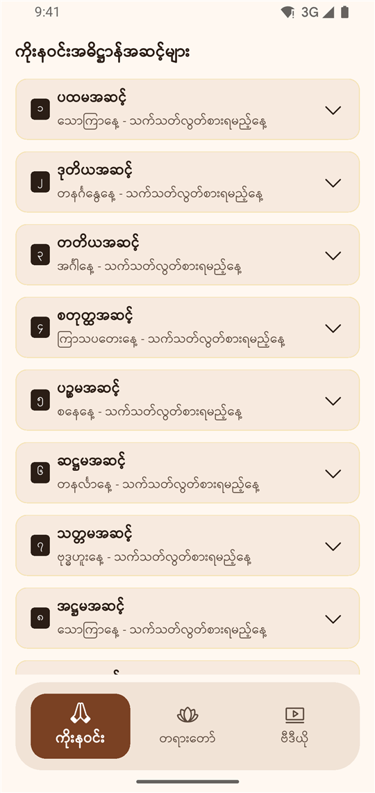
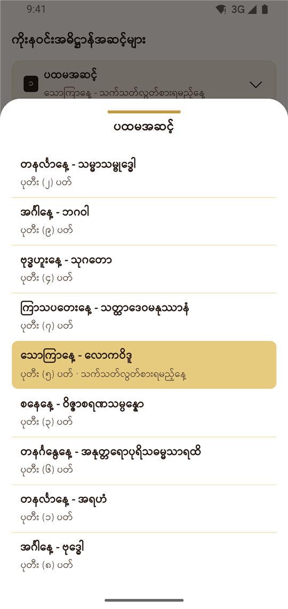
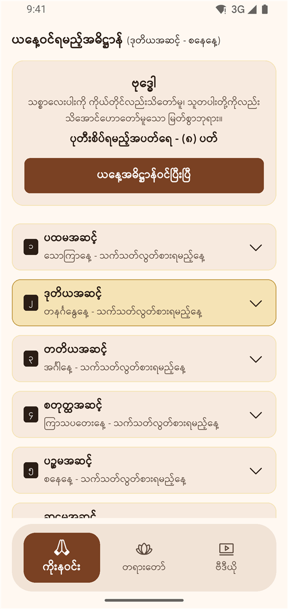
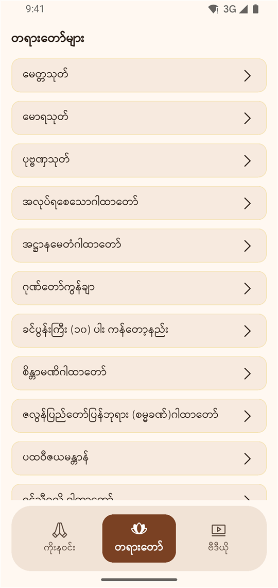
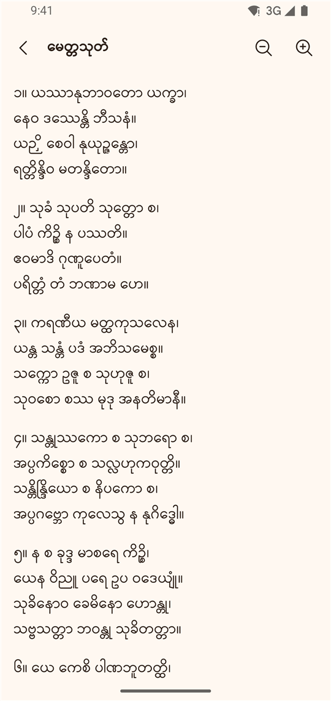

<p align="center">
  
</p>

<h1 align="center">ကိုးနဝင်း အဓိဋ္ဌာန် နှင့် တရားတော်</h1>

<p align="center">
  ကိုးနဝင်း အဓိဋ္ဌာန် ရက် ၈၁ ရက်ကို နေ့စဉ် လမ်းညွှန်ပေးပြီး ဂါထာတော်များ ရွတ်ဖတ်နိုင်၊ တရားတော် ဗီဒီယိုများ နာကြားနိုင်သော Android app
</p>

<p align="center">
  <a href="https://www.behance.net/gallery/258842649/KoeNaWin-Dhamma-UXUI-Case-Study">Behance case study</a>
</p>

---

## Screenshots

<table>
  <tr>
    <td align="center"><br>Splash</td>
    <td align="center"><br>ကိုးနဝင်း အဆင့်များ</td>
    <td align="center"><br>အဆင့်အလိုက် ရက် ၉ ရက်</td>
    <td align="center"><br>ယနေ့ ဝင်ရမည့် အဓိဋ္ဌာန်</td>
  </tr>
  <tr>
    <td align="center"><br>တရားတော်များ</td>
    <td align="center"><br>ဂါထာတော်</td>
    <td align="center"><br>ဗီဒီယို</td>
    <td></td>
  </tr>
</table>

## လုပ်ဆောင်ချက်များ

### 🙏 ကိုးနဝင်း
- အဆင့် ၉ ဆင့် × ရက် ၉ ရက် = **ရက် ၈၁ ရက်** ဇယား။ အဆင့်တိုင်း၏ သက်သတ်လွတ်နေ့ကို ပြသည်။
- **ယနေ့ ဝင်ရမည့် အဓိဋ္ဌာန်**: ဂုဏ်တော်၊ အဓိပ္ပာယ်၊ ပုတီးစိပ်ရမည့် အပတ်ရေ
- **တနင်္လာနေ့** တွင်သာ စတင်ဝင်နိုင်သည်။ အရင်က ဝင်ထားသူများ အဆင့်နှင့် ရက်ကို ရွေး၍ ဆက်ဝင်နိုင်သည်။
- ရက်ပျက်ကွက်ပါက သတိပေးပြီး အစမှ ပြန်စရသည်။
- ရက် ၈၁ ပြည့်ပါက ပြည့်မြောက်ကြောင်း ပြသည်။
- **မနက် ၆ နာရီ** တိုင်း ယနေ့ ဂုဏ်တော်နှင့်အတူ သတိပေးချက် (notification) ပို့သည်။

### 🪷 တရားတော်
- ဂါထာတော် **၁၄ ပုဒ်** (မေတ္တသုတ်၊ မောရသုတ်၊ ပုဗ္ဗဏှသုတ်၊ ဂုဏ်တော်ကွန်ချာ စသည်)
- စာလုံး ချဲ့/ချုံ့ နိုင်သည်။ ရှေ့/နောက် ဂါထာသို့ သွားနိုင်သည်။

### ▶️ ဗီဒီယို
- **မနက်ပိုင်း / ညနေပိုင်း** YouTube တရားတော်များ
- နှိပ်လိုက်သော ဗီဒီယိုမှစ၍ ကျန်ဗီဒီယိုများကို အစဉ်လိုက် ဆက်တိုက်ဖွင့်ပေးသည်။

---

## Case study

**[View the UX/UI case study on Behance →](https://www.behance.net/gallery/258842649/KoeNaWin-Dhamma-UXUI-Case-Study)**

It covers research, competitive analysis, design decisions and how the Figma design maps to this code. The text is also in [docs/behance/case_study.md](docs/behance/case_study.md), and a short demo video is in [docs/behance/koenawin_demo.mp4](docs/behance/koenawin_demo.mp4).

## Features (English)

- **KoeNaWin**: the 81-day schedule (9 stages × 9 days), a daily task card, starting on Mondays only, resuming at a chosen day, a reset when a day is missed, a completion screen, and daily 6 AM reminders.
- **Dhamma**: 14 Pali gathas with adjustable text size and previous/next navigation.
- **Video**: morning and evening YouTube dhamma talks, played one after another.
- Android only, light theme, Myanmar UI with the Pyidaungsu font.

## Tech stack

| | |
|---|---|
| Framework | Flutter 3.38 (Dart 3.10) · Material 3 |
| State | `provider` · `shared_preferences` |
| Notifications | `flutter_local_notifications` · `timezone` |
| Video | `webview_flutter` (YouTube embed) · `wakelock_plus` |
| Icons | Phosphor Icons (`phosphor_flutter`) |
| Font | Pyidaungsu (Regular, Bold) |

## Getting started

```bash
flutter pub get
flutter run
```

Run the tests:

```bash
flutter test
```

## Project structure

```
lib/
  core/            theme (design tokens), Myanmar digits/dates, shared widgets
  features/
    splash/        splash screen
    home/          bottom tab shell
    koenawin/      81-day schedule, progress, reminders
    dhamma/        gatha list and reader
    video/         YouTube sessions and player
assets/
  branding/        logo and app icon (SVG + rendered PNGs)
  data/            schedule, attributes and gathas (JSON)
  fonts/           Pyidaungsu
docs/
  design_tokens.md colors, typography, effects, layout, motion, naming
tools/
  build_data.py    KoeNaWin.xlsx → assets/data/*.json
  icons/           renders launcher icon and splash PNGs from the SVGs
```

## Data

The schedule, Buddha attributes and gathas come from `KoeNaWin.xlsx`. After editing the spreadsheet, regenerate the JSON:

```bash
python tools/build_data.py KoeNaWin.xlsx assets/data
```

The script also applies the agreed spelling fixes, so they carry over to every regeneration.

## App icon and splash

```bash
powershell -File tools/icons/render_icons.ps1
dart run flutter_launcher_icons
dart run flutter_native_splash:create
```

## Release build

Releases are signed with a private key that is **not** in this repository. Create `android/key.properties`:

```properties
storeFile=C:/path/to/koenawin-release.jks
keyAlias=koenawin
storePassword=...
keyPassword=...
```

Then build:

```bash
flutter build apk --release
```

Without `key.properties`, release builds fall back to the debug key. Sign every update with the same key and raise `version` in `pubspec.yaml`, so the update installs over the old app and keeps the user's progress.

## Notes

- **YouTube in a WebView**: the embed page is requested with `Referer: https://com.koenawin.koenawin_dhamma`, because YouTube rejects anonymous embeds (error 150/152). If the application ID changes, update `lib/features/video/widgets/youtube_view.dart` as well.
- **"Sign in to confirm you're not a bot"**: YouTube shows this on VPN connections. The app detects it and asks the user to turn off the VPN.
